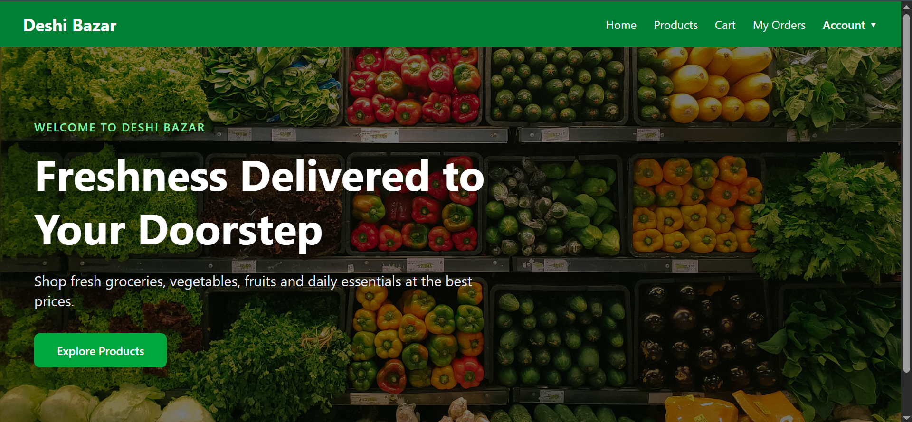
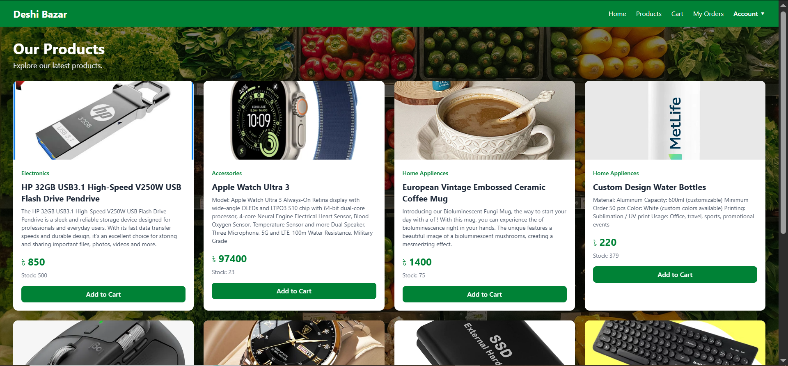
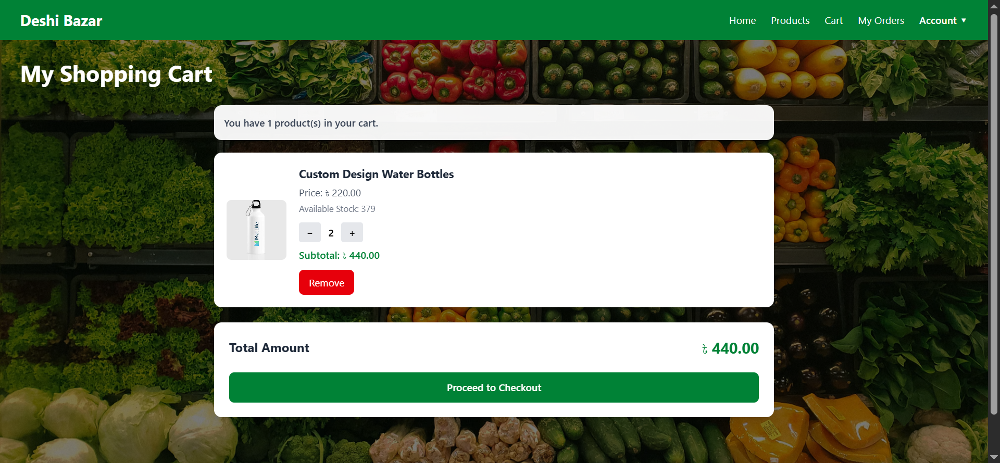

# 🛒 Deshi Bazar – Online Grocery Shopping Platform

**Deshi Bazar** is a full-stack online grocery shopping platform designed to make grocery shopping easier and more convenient. Customers can browse products, manage their shopping carts, place orders, and complete demo payments, while administrators can manage products, inventory, orders, and users through a dedicated dashboard.

---

## 📸 Project Screenshots

### Home Page


### Products Page


### Shopping Cart


---

## 📖 Project Overview

Deshi Bazar is a role-based e-commerce application that provides separate experiences for customers and administrators.

Customers can register, log in, explore available grocery products, add products to their carts, adjust quantities, place orders, and track their order status.

Administrators can manage the entire shopping platform, including products, stock inventory, customer accounts, and orders.

The application uses JWT-based authentication and role-based authorization to protect its APIs and restrict access to specific features.

---

## ✨ Key Features

### 👤 Authentication & Authorization
- Customer registration and login.
- JWT-based authentication.
- Access token and refresh token support.
- Role-based access control.
- BCrypt password encryption.
- Separate access permissions for Admin, Seller, and Customer roles.

### 🛍️ Customer Features
- Browse available grocery products.
- View product information and prices.
- Add products to the shopping cart.
- Increase or decrease product quantities.
- Remove products from the cart.
- Place orders.
- Complete demo payments.
- View order history.
- Track order status.
- Cancel eligible orders.

### 🛠️ Admin Dashboard
- Admin dashboard overview.
- Product management (Create, Read, Update, Delete).
- Upload product images.
- Soft-delete products.
- Inventory management.
- Stock-in and stock-out operations.
- View and manage customer orders.
- Update order statuses.
- View registered users.

### 📦 Order & Inventory Management
- Automatic stock validation during order placement.
- Order and order-item management.
- Order status tracking.
- Inventory stock updates.
- Protection against ordering inactive products.
- Order history preservation.

---

## 🧰 Technology Stack

### Backend
- Java 21
- Spring Boot
- Spring Data JPA
- Spring Security
- JWT Authentication
- Gradle
- PostgreSQL
- Hibernate
- BCrypt

### Frontend
- React
- TypeScript
- Vite
- Tailwind CSS
- Axios
- React Router

### Development Tools
- IntelliJ IDEA
- Visual Studio Code
- Postman
- pgAdmin
- Git
- GitHub

---

## 🏗️ Project Architecture

The project follows a feature-based package structure in the backend to keep the code organized and maintainable.

```text
deshi-bazar/
│
├── backend/
│   └── src/main/java/com/sajib/deshibazar/
│       ├── auth/
│       ├── product/
│       ├── cart/
│       ├── order/
│       ├── payment/
│       ├── inventory/
│       ├── user/
│       └── common/
│
├── frontend/
│   └── src/
│       ├── api/
│       ├── components/
│       ├── layouts/
│       ├── pages/
│       └── ...
│
├── docs/
│   └── screenshots/
│
└── README.md
```

---

## 🔐 User Roles

| Role | Access |
|---|---|
| ADMIN | Manage products, inventory, orders, and users |
| SELLER | Role-based seller access |
| CUSTOMER | Browse products, manage cart, place orders, and view orders |

---

## ⚙️ Installation & Setup

### Prerequisites

Make sure you have installed:

- Java 21
- Node.js and npm
- PostgreSQL
- Git

### 1. Clone the Repository

```bash
git clone https://github.com/mazharulislamsajib01/deshi-bazar.git
```

```bash
cd deshi-bazar
```

### 2. Backend Setup

Navigate to the backend directory:

```bash
cd backend
```

Configure your PostgreSQL database and application properties.

Then run the application:

```bash
gradlew bootRun
```

Backend server:

```text
http://localhost:8080
```

### 3. Frontend Setup

Open another terminal and navigate to the frontend directory:

```bash
cd frontend
```

Install dependencies:

```bash
npm install
```

Start the frontend:

```bash
npm run dev
```

Frontend application:

```text
http://localhost:5173
```

---

## 🗄️ Database

Deshi Bazar uses PostgreSQL as its relational database.

The backend uses Spring Data JPA and Hibernate for database operations and entity management.

Configure your database credentials in the backend configuration before running the application.

---

## 🔑 Security

- JWT-based authentication.
- Protected API endpoints.
- Role-based authorization.
- Password hashing with BCrypt.
- Secure access to customer and administrative features.

---

## 🚀 Future Improvements

- Integration with a real payment gateway.
- Product search and advanced filtering.
- Product reviews and ratings.
- Email notifications for order updates.
- Improved sales analytics and reporting.
- Enhanced seller management features.

---

## 👨‍💻 Developer

**MD Mazharul Islam Sajib**

- GitHub: [mazharulislamsajib01](https://github.com/mazharulislamsajib01)
- LinkedIn: [MD Mazharul Islam Sajib](https://www.linkedin.com/in/mazharulislamsajib/)

---

## 📄 License

This project is developed for educational and portfolio purposes.

---

**⭐ If you find this project interesting, feel free to explore the repository!**
